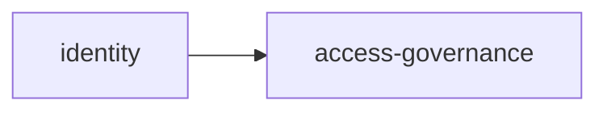

# Arquitetura — {{nome}}

## 1. Perfil escolhido e justificativa
Perfil: · Desvios (cada um com ADR):

## 2. Mapa de módulos
| Módulo | Tipo (fundação/domínio) | Responsabilidade | Agregados | Regras (RN) | Depende de |
|---|---|---|---|---|---|

## 3. Ordem de construção (Fase 4)

## 4. Modelo de dados (alto nível) e estratégia de tenant

## 5. Infraestrutura
Serviços do Docker Compose · ambientes · deploy · backup · monitoramento

## 6. MCPs recomendados
| MCP | Uso |
|---|---|

## 7. Skills do projeto

## 8. Riscos e premissas

## 9. ADRs

---
**Aprovação:** ☐ arquitetura aprovada — nome/data
